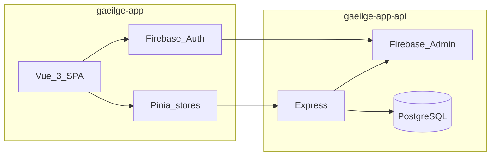

# Architecture

## High-level diagram

## Frontend (`gaeilge-app`)

| Layer | Role |
|-------|------|
| **Vue Router** | Routes, `requiresAuth` meta, navigation guard (auth or guest). |
| **Pinia** | `useAuthStore`, `useQuizStore`, `useMatchingStore`, `useNotecardStore`, `useCategoryStore`. |
| **Services** | Axios `httpClient` + domain services (`auth.service`, `notecards.service`, …). |
| **Quiz data** | Static `quizQuestions.json` loaded via `quiz.service` (no API for quiz content today). |
| **Notecards / categories** | REST API against `VITE_API_BASE_URL`. |

## Backend (`gaeilge-app-api`)

- **Express** on Node 20+, deployed as a Vercel serverless function (`@vercel/node`).
- **PostgreSQL** via `pg` pool; migrations under `src/migrations/`.
- **Firebase Admin** verifies ID tokens; middleware supports **guest** requests with `X-Guest-Mode: true`.

## Auth flow (signed-in)

1. User signs in with Firebase client SDK.
2. Client obtains an ID token and calls `/auth/users/login` with `idToken`.
3. API verifies token, sets `httpOnly` cookie `access_token`, returns app user from DB.
4. Subsequent API calls send `Authorization: Bearer <token>` (see `httpClient.ts`).

## Auth flow (guest)

1. User chooses **Continue as guest**; `useAuthStore` sets guest mode and persists a flag in `localStorage`.
2. `httpClient` adds `X-Guest-Mode: true` for API requests when guest mode is active.

## Deployment

- Frontend: Vercel SPA with rewrites to `index.html`.
- API: Vercel serverless + Postgres; see `gaeilge-app-api/DEPLOYMENT.md` for migrations and env vars.
